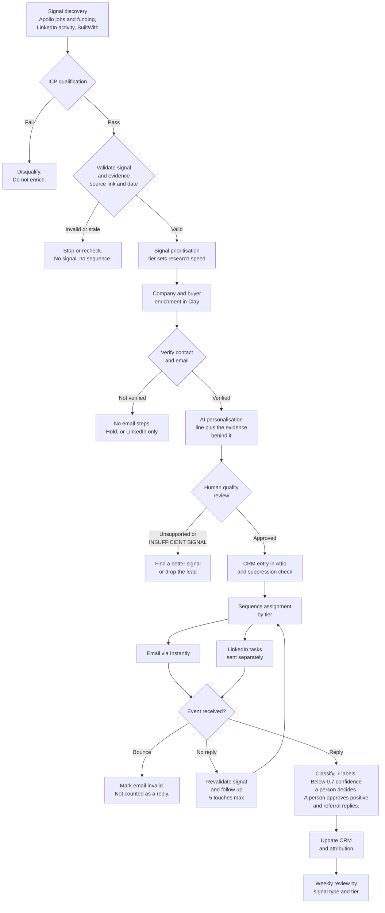

# Signal-Led Outbound

An AI-ready operating playbook for B2B SaaS outbound, built around real company signals rather than static prospect lists.

Covers signal discovery, ICP qualification, enrichment, evidence-backed personalisation, sequencing, reply handling and pipeline measurement.

`SKILL.md` is written in Claude's native skill format. It works with ChatGPT or any other AI assistant too: give it the file as the brief (see "How to use it").

Most outbound fails because of timing, not copy. A good email sent when nothing is going on at the company gets ignored. The same email sent the week they open a Head of Marketing role gets read. This workflow only builds a sequence when there is a real, checked signal to point at.

---

## The workflow in one picture



Every step has a stop rule. That is the point. A lead that fails a check does not move forward.

---

## What it covers

- **ICP definition**: who to target and who to disqualify.
- **Signal tiers**: how fast to research an account. Tier 1 (today), Tier 2 (this week), Tier 3 (opportunistic).
- **Clay workflow**: a 5-step enrichment and sequencing logic.
- **Personalisation prompt**: paste it into an AI column in Clay. It returns the line and the evidence behind it.
- **Hard rules**: what never to do.
- **Reply handling, follow-up, deliverability and measurement**: the part after the send.

---

## How a lead moves through it

Signal tiers determine research and outreach priority, not confirmed purchasing intent. Validate the commercial relevance of each signal before contacting the account.

| Signal tier | Example signal | Sequence, once the signal is validated |
|---|---|---|
| Tier 1, research today | Hiring a Head of Marketing, Growth Lead or SDR. Series A or B in the last 90 days. | 5 touches: 3 emails and 2 LinkedIn |
| Tier 2, research this week | 3+ GTM roles open at once. Founder posting about pipeline or outbound. | 3 emails |
| Tier 3, opportunistic | HubSpot in the stack and no outbound tooling. A job post that names Clay or Apollo but has no owner. | 2 emails |

---

## One lead, start to finish

This is a made-up lead. It shows the logic. See [`examples/`](examples/) for a full sample run.

**Signal:** Northwind Metrics (sample company) opened a Head of Marketing role, and the founder posted that they still run sales themselves. Two signals that tell one story.

1. **Signal and ICP check.** B2B SaaS, an estimated $1M to $10M ARR, 10 to 80 people. It passes.
2. **Enrich.** Company, ARR range, tech stack, signal type, signal detail, source links, buyer name and title, verified email. All present, so it continues.
3. **Personalisation line from the AI:**
   > Opening a Head of Marketing role while still handling sales yourself suggests you're building out the commercial function.

   The line uses only what the evidence shows: the job post and the founder's own post saying they still run sales. It does not claim they own all of pipeline or that they are under pressure, because nothing in the record says so. Without the founder's post, the line would be about the role only.
4. **Human review.** A person checks the line against the evidence before it is used.
5. **Log it** with the signal type and date before anything is sent.
6. **Sequence.** Tier 1, so 3 emails and 2 LinkedIn touches.

A lead with no signal detail stops at step 2. A lead outside the ARR range is dropped at step 1. Both cases are in the sample data.

---

## After the send: replies, follow-up and measurement

Most outbound workflows stop at "send". This one covers the rest. The full detail is in [`SKILL.md`](SKILL.md) sections 7 to 12.

- **Reply handling.** Each reply gets one of seven labels (`positive`, `not_now`, `referral`, `not_interested`, `unsubscribe`, `auto_reply`, `unclear`) from a JSON-only Claude prompt. Headers are checked before anything else, so a bounce is handled as a delivery failure and an out-of-office footer is never read as an opt-out. Below 0.7 confidence, a person decides.
- **One action per label.** Positive replies stop the sequence and get a drafted reply with a booking link. Referrals become new contacts. Unsubscribes are suppressed within the hour.
- **A person approves** every reply to a positive or a referral. Only the unsubscribe confirmation sends on its own.
- **Follow-up by tier.** Fixed day offsets, no two touches within 3 days, 5 touches at most across email and LinkedIn, a new angle each time, and a signal re-check before the first touch and again before touch 3.
- **Sending safeguards.** Separate sending domains where appropriate, SPF, DKIM and DMARC, warm-up, volume caps, and pause rules for bounces and spam complaints. All figures are starting defaults.
- **Measurement.** Defined formulas from replies through to qualified pipeline, cut by signal type, tier and touch number. 100 delivered sends is the first review point for a segment. Smaller samples are reported as observed results, not conclusions.

Samples for all of it are in [`examples/`](examples/).

---

## The personalisation prompt

Paste this into the AI column in Clay (Claude is the default, any capable model works).

```
You are writing one personalisation line for a cold outbound email or LinkedIn message.

Signal: [insert signal type and detail]
Source: [where the signal was found, and the date]
Company: [company name]
Buyer: [first name], [title]
Product: [one-line description of what's being sold]

Rules:
- One sentence, max 20 words
- Open with the observation, not "I noticed" or "I saw"
- Connect the signal to a relevant business problem only where the evidence above supports it
- Use only the facts above. Do not invent numbers, plans or problems
- Never state a guess about their situation as fact
- Do not imply pressure, urgency or pain unless the evidence shows it
- Do not name the product
- Do not compliment them
- British English
- If the signal is too thin to write a true line, return INSUFFICIENT SIGNAL

Return:
Observation: [the verified fact, with its date]
Evidence: [the source it came from]
Possible implication: [what it may mean, written as a possibility]
Confidence: [low, medium or high]
Line: [the personalisation line, or INSUFFICIENT SIGNAL]
```

Returning the evidence with the line lets a person check the output in seconds before it is used.

| Output | Example |
|---|---|
| Observation | Head of Marketing role published on 27 October |
| Evidence | The original job post |
| Possible implication | The company may be building out marketing leadership |
| Confidence | Medium |
| Line | "Your Head of Marketing search suggests you're investing in building out the marketing function." |

**Bad:** "I love what you're building."
**Good:** "Hiring a Growth Lead while still handling sales yourself suggests you're building out the commercial function."

The good line only works when the record shows the founder still handles sales, for example from their own post. Without that fact, write about the role, not the founder.

---

## Hard rules

- No signal means no sequence.
- No LinkedIn compliments as personalisation lines. They read as AI straight away.
- Never push to the CRM before the signal type and source are logged.
- Never state a guess about the buyer's situation as fact.
- Email 1 is one problem, one proof, one ask. It is not a product pitch.
- Never exceed 5 touches per contact across email and LinkedIn combined.
- Never invent ARR, funding or headcount data. Pull it from Apollo or leave it blank.
- Verify every email address before it enters a sequence.

---

## The same method on a fractional practice

I use the same logic for my own pipeline at Grow Wasabi, where I sell fractional marketing leadership to early-stage B2B security startups.

- **ICP filter:** $2M to $8M raised, paying customers, no marketing lead, 5 to 25 people.
- **Signal:** a recent raise with no marketing hire on the team.
- **Two angles by stage:** newer companies get "here is what happens in the next 12 months without marketing in place". Companies 12 to 18 months past their raise get "your Series A pipeline needs to be there, here is what I would do in 90 days".
- **Channel:** LinkedIn first, email as backup.
- **Pace:** about 10 companies a month, each one researched by hand.

---

## Stack

```
Clay → Claude → Attio → Instantly
```

- **Clay**: signal import, enrichment, personalisation through a Claude column.
- **Claude**: writes one signal-based line per lead, with the evidence behind it, for a person to review.
- **Attio**: CRM entry and signal logging.
- **Instantly**: sequence delivery by tier.

---

## Results

I used this method in an account-based outbound campaign for a client.

| Metric | Signal-led campaign | Earlier campaign |
|---|---|---|
| Target accounts | 1,000 | |
| Emails delivered | About 4,000 | |
| Positive response rate | 17% | 2 to 3% |

A positive reply is a request for more information, a call or a meeting, or a meeting booked straight from the link.

The earlier campaign used standard Clay personalisation. The two campaigns are not a controlled test, since the lists, timing and offer were different. Client details are withheld.

---

## Tools I work in

| What it does | Tools |
|---|---|
| Outbound sequencing | Instantly, SmartLead, Lemlist, Plusvibe |
| Data and enrichment | Clay, Apollo, Hunter.io, Leadfeeder, Apify, PhantomBuster |
| Automation and AI | Claude, Claude Code, Cursor, n8n, Make |
| CRM and ops | HubSpot, Salesforce, Attio, Notion |
| Paid, SEO and analytics | Google Ads, LinkedIn Ads, SEMrush, Ahrefs, Google Analytics, Mailchimp, Buffer |

---

## How to use it

1. Copy `SKILL.md` into your Claude skills folder. Using ChatGPT or another assistant? Upload `SKILL.md` or paste it in as the brief at the start of the chat, then ask it to work through your leads with it.
2. In Clay, reference the personalisation prompt in your AI column.
3. Map your signal source to the right tier.
4. Follow `SKILL.md` sections 4 to 8 in order, from signal import to follow-up.
5. Do not skip the hard rules.

This is a method, not a running system. It does not connect to Clay, Attio or Instantly by itself. You set up the tools. The method tells you what to check at each step.

---

## Who this is for

Built for B2B SaaS founders, growth marketers and GTM operators who want to build or improve a signal-led outbound motion. Familiarity with Clay and outbound tooling is helpful, but the methodology can be adapted to other stacks.

---

Built by [Chandana Pitta](https://www.linkedin.com/in/chandanapitta). Free to use, adapt and share.
