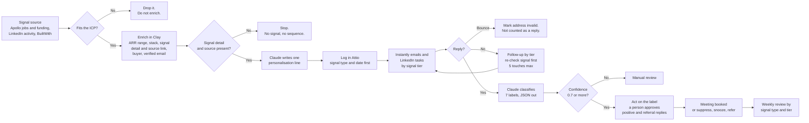

# Signal-Led Outbound

A Claude skill and workflow for B2B outbound that starts from a buying signal, not a static list.

Most outbound fails because of timing, not copy. A good email sent when nothing is going on at the company gets ignored. The same email sent the week they open a Head of Marketing role gets read. This workflow only builds a sequence when there is a real signal to point at.

---

## The workflow in one picture



Every step has a stop rule. That is the point. A lead that fails a check does not move forward.

---

## What it covers

- **ICP definition**: who to target and who to disqualify.
- **Signal tiers**: Tier 1 (act today), Tier 2 (this week), Tier 3 (opportunistic).
- **Clay workflow**: a 5-step enrichment and sequencing logic.
- **Claude personalisation prompt**: paste it into a Clay Claude column.
- **Hard rules**: what never to do.
- **Reply handling, follow-up, deliverability and measurement**: the part after the send.

---

## How a lead moves through it

| Signal tier | Example signal | What happens |
|---|---|---|
| Tier 1, act today | Hiring a Head of Marketing, Growth Lead or SDR. Series A or B in the last 90 days. | 5 touches: 3 emails and 2 LinkedIn |
| Tier 2, this week | 3+ GTM roles open at once. Founder posting about pipeline or outbound. | 3 emails |
| Tier 3, opportunistic | HubSpot in the stack and no outbound tooling. A job post that names Clay or Apollo but has no owner. | 2 emails |

---

## One lead, start to finish

This is a made-up lead. It shows the logic. See [`examples/`](examples/) for a full sample run.

**Signal:** Northwind Metrics (sample company) opened a Head of Marketing role, and the founder posted that they still run sales themselves. Two signals that tell one story.

1. **Signal and ICP check.** B2B SaaS, an estimated $1M to $10M ARR, 10 to 80 people. It passes.
2. **Enrich.** Company, ARR range, tech stack, signal type, signal detail, source links, buyer name and title, verified email. All present, so it continues.
3. **Personalisation line from Claude:**
   > Opening a Head of Marketing role while you still own pipeline yourself is a particular kind of pressure.

   The line works because the founder's own post says they own pipeline. Without that post, the line would be about the role only.
4. **Log it** with the signal type and date before anything is sent.
5. **Sequence.** Tier 1, so 3 emails and 2 LinkedIn touches.

A lead with no signal detail stops at step 2. A lead outside the ARR range is dropped at step 1. Both cases are in the sample data.

---

## After the send: replies, follow-up and measurement

Most outbound workflows stop at "send". This one covers the rest. The full detail is in [`SKILL.md`](SKILL.md) sections 7 to 12.

- **Reply handling.** Each reply gets one of seven labels (`positive`, `not_now`, `referral`, `not_interested`, `unsubscribe`, `auto_reply`, `unclear`) from a JSON-only Claude prompt. Headers are checked before anything else, so a bounce is handled as a delivery failure and an out-of-office footer is never read as an opt-out. Below 0.7 confidence, a person decides.
- **One action per label.** Positive replies stop the sequence and get a drafted reply with a booking link. Referrals become new contacts. Unsubscribes are suppressed within the hour.
- **A person approves** every reply to a positive or a referral. Only the unsubscribe confirmation sends on its own.
- **Follow-up by tier.** Fixed day offsets, no two touches within 3 days, 5 touches at most across email and LinkedIn, a new angle each time, and a signal re-check before the first touch and again before touch 3.
- **Sending safeguards.** Secondary domains, SPF, DKIM and DMARC, warm-up, volume caps, and pause rules for bounces and spam complaints. All figures are starting defaults.
- **Measurement.** Defined formulas from replies through to qualified pipeline, cut by signal type, tier and touch number. No segment is judged before 100 delivered sends, and 100 is a first look, not proof.

Samples for all of it are in [`examples/`](examples/).

---

## The personalisation prompt

Paste this into the Claude column in Clay.

```
You are writing one personalisation line for a cold outbound email or LinkedIn message.

Signal: [insert signal type and detail]
Source: [where the signal was found, and the date]
Company: [company name]
Buyer: [first name], [title]
Product: [one-line description of what's being sold]

Rules:
- One sentence, max 20 words
- Open with the observation, not "I noticed" or "I saw"
- Connect the signal to the problem it usually points to
- Use only the facts above. Do not invent numbers, plans or problems
- Never state a guess about their situation as fact
- Do not name the product
- Do not compliment them
- British English
- If the signal is too thin to write a true line, return INSUFFICIENT SIGNAL
```

**Bad:** "I love what you're building."
**Good:** "Posting a Growth Lead role while still owning pipeline yourself is a specific kind of pressure."

The good line only works when the record shows the founder still owns pipeline. Without that fact, write about the role, not the founder.

---

## Hard rules

- No signal means no sequence.
- No LinkedIn compliments as personalisation lines. They read as AI straight away.
- Never push to the CRM before the signal type and source are logged.
- Never state a guess about the buyer's situation as fact.
- Email 1 is one problem, one proof, one ask. It is not a product pitch.
- Never exceed 5 touches per contact across email and LinkedIn combined.
- Never invent ARR, funding or headcount data. Pull it from Apollo or leave it blank.
- Verify every email address before it enters a sequence.

---

## The same method on a fractional practice

I use the same logic for my own pipeline at Grow Wasabi, where I sell fractional marketing leadership to early-stage B2B security startups.

- **ICP filter:** $2M to $8M raised, paying customers, no marketing lead, 5 to 25 people.
- **Signal:** a recent raise with no marketing hire on the team.
- **Two angles by stage:** newer companies get "here is what happens in the next 12 months without marketing in place". Companies 12 to 18 months past their raise get "your Series A pipeline needs to be there, here is what I would do in 90 days".
- **Channel:** LinkedIn first, email as backup.
- **Pace:** about 10 companies a month, each one researched by hand.

---

## Stack

```
Clay → Claude → Attio → Instantly
```

- **Clay**: signal import, enrichment, personalisation through a Claude column.
- **Claude**: writes one signal-based line per lead.
- **Attio**: CRM entry and signal logging.
- **Instantly**: sequence delivery by tier.

---

## Results

I used this method in an account-based outbound campaign for a client.

| Metric | Result |
|---|---|
| Target accounts | 1,000 |
| Emails delivered | About 4,000 |
| Positive reply rate | 17% of delivered emails |
| Compared with an earlier campaign | About 6 to 8x (2 to 3% before) |

A positive reply is a request for more information, a call or a meeting, or a meeting booked straight from the link.

The earlier campaign used standard Clay personalisation. The two campaigns are not a controlled test, since the lists, timing and offer were different. Client details are withheld.

---

## Tools I work in

| What it does | Tools |
|---|---|
| Outbound sequencing | Instantly, SmartLead, Lemlist, Plusvibe |
| Data and enrichment | Clay, Apollo, Hunter.io, Leadfeeder, Apify, PhantomBuster |
| Automation and AI | Claude, Claude Code, Cursor, n8n, Make |
| CRM and ops | HubSpot, Salesforce, Attio, Notion |
| Paid, SEO and analytics | Google Ads, LinkedIn Ads, SEMrush, Ahrefs, Google Analytics, Mailchimp, Buffer |

---

## How to use it

1. Copy `SKILL.md` into your Claude skills folder. Not using Claude? Give `SKILL.md` to any AI assistant as the brief.
2. In Clay, reference the personalisation prompt in your Claude column.
3. Map your signal source to the right tier.
4. Follow `SKILL.md` sections 4 to 8 in order, from signal import to follow-up.
5. Do not skip the hard rules.

This is a method, not a running system. It does not connect to Clay, Attio or Instantly by itself. You set up the tools. The method tells you what to check at each step.

---

## Who this is for

B2B SaaS founders and operators who already run Clay outbound and are stuck under 3% reply rates. It is not a beginner's guide to cold email. It assumes you have the stack and want better logic.

---

Built by [Chandana Pitta](https://www.linkedin.com/in/chandanapitta). Free to use, adapt and share.
