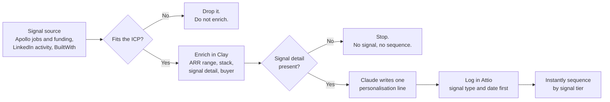

# Signal-Led Outbound

A Claude skill and workflow for B2B outbound that starts from a buying signal, not a static list.

Most outbound fails because of timing, not copy. A good email sent when nothing is going on at the company gets ignored. The same email sent the week they open a Head of Marketing role gets read. This workflow only builds a sequence when there is a real signal to point at.

---

## The workflow in one picture



Every step has a stop rule. That is the point. A lead that fails a check does not move forward.

---

## What it covers

- **ICP definition**: who to target and who to disqualify.
- **Signal tiers**: Tier 1 (act today), Tier 2 (this week), Tier 3 (opportunistic).
- **Clay workflow**: a 5-step enrichment and sequencing logic.
- **Claude personalisation prompt**: paste it into a Clay Claude column.
- **Hard rules**: what never to do.

---

## How a lead moves through it

| Signal tier | Example signal | What happens |
|---|---|---|
| Tier 1, act today | Hiring a Head of Marketing, Growth Lead or SDR. Series A or B in the last 90 days. | 5 touches: 3 emails and 2 LinkedIn |
| Tier 2, this week | 3+ GTM roles open at once. Founder posting about pipeline or outbound. | 3 emails |
| Tier 3, opportunistic | HubSpot in the stack and no outbound tooling. A job post that names Clay or Apollo but has no owner. | 2 emails |

---

## One lead, start to finish

This is a made-up lead. It shows the logic. See [`examples/`](examples/) for a full sample run.

**Signal:** Northwind Metrics (sample company) opened a Head of Marketing role. The founder still owns pipeline.

1. **Signal and ICP check.** B2B SaaS, an estimated $1M to $10M ARR, 10 to 80 people. It passes.
2. **Enrich.** Company, ARR range, tech stack, signal type, signal detail, buyer name and title. All present, so it continues.
3. **Personalisation line from Claude:**
   > Opening a Head of Marketing role while you still own pipeline yourself is a particular kind of pressure.
4. **Log it** with the signal type and date before anything is sent.
5. **Sequence.** Tier 1, so 3 emails and 2 LinkedIn touches.

A lead with no signal detail stops at step 2. A lead outside the ARR range is dropped at step 1. Both cases are in the sample data.

---

## The personalisation prompt

Paste this into the Claude column in Clay.

```
You are writing one personalisation line for a cold outbound email or LinkedIn message.

Signal: [insert signal type and detail]
Company: [company name]
Buyer: [first name], [title]
Product: [one-line description of what's being sold]

Rules:
- One sentence, max 20 words
- Open with the observation, not "I noticed" or "I saw"
- Connect the signal to the pressure the buyer is feeling right now
- Do not name the product
- Do not compliment them
- British English
```

**Bad:** "I love what you're building."
**Good:** "Posting a Growth Lead role while still owning pipeline yourself is a specific kind of pressure."

---

## Hard rules

- No signal means no sequence.
- No LinkedIn compliments as personalisation lines. They read as AI straight away.
- Never push to the CRM before the signal type is logged.
- Email 1 is one problem, one proof, one ask. It is not a product pitch.
- Never exceed 5 touches per contact across email and LinkedIn combined.
- Never invent ARR, funding or headcount data. Pull it from Apollo or leave it blank.

---

## The same method on a fractional practice

I use the same logic for my own pipeline at Grow Wasabi, where I sell fractional marketing leadership to early-stage B2B security startups.

- **ICP filter:** $2M to $8M raised, paying customers, no marketing lead, 5 to 25 people.
- **Signal:** a recent raise with no marketing hire on the team.
- **Two angles by stage:** newer companies get "here is what happens in the next 12 months without marketing in place". Companies 12 to 18 months past their raise get "your Series A pipeline needs to be there, here is what I would do in 90 days".
- **Channel:** LinkedIn first, email as backup.
- **Pace:** about 10 companies a month, each one researched by hand.

---

## Stack

```
Clay → Claude → Attio → Instantly
```

- **Clay**: signal import, enrichment, personalisation through a Claude column.
- **Claude**: writes one signal-based line per lead.
- **Attio**: CRM entry and signal logging.
- **Instantly**: sequence delivery by tier.

---

## Results

| Metric | Standard Clay Personalisation | Signal-Led |
|--------|-------------------------------|------------|
| Positive reply rate | 2–3% | 17% (top quartile) |
| Reply rate multiplier | 1x | 9x |
| Meetings booked | baseline | 3.4x more |

---

## Tools I work in

| What it does | Tools |
|---|---|
| Outbound sequencing | Instantly, SmartLead, Lemlist, Plusvibe |
| Data and enrichment | Clay, Apollo, Hunter.io, Leadfeeder, Apify, PhantomBuster |
| Automation and AI | Claude, Claude Code, Cursor, n8n, Make |
| CRM and ops | HubSpot, Salesforce, Attio, Notion |
| Paid, SEO and analytics | Google Ads, LinkedIn Ads, SEMrush, Ahrefs, Google Analytics, Mailchimp, Buffer |

---

## How to use it

1. Copy `SKILL.md` into your Claude skills folder.
2. In Clay, reference the personalisation prompt in your Claude column.
3. Map your signal source to the right tier.
4. Follow the five workflow steps in order.
5. Do not skip the hard rules.

---

## Who this is for

B2B SaaS founders and operators who already run Clay outbound and are stuck under 3% reply rates. It is not a beginner's guide to cold email. It assumes you have the stack and want better logic.

---

Built by [Chandana Pitta](https://www.linkedin.com/in/chandanapitta). Free to use, adapt and share.
